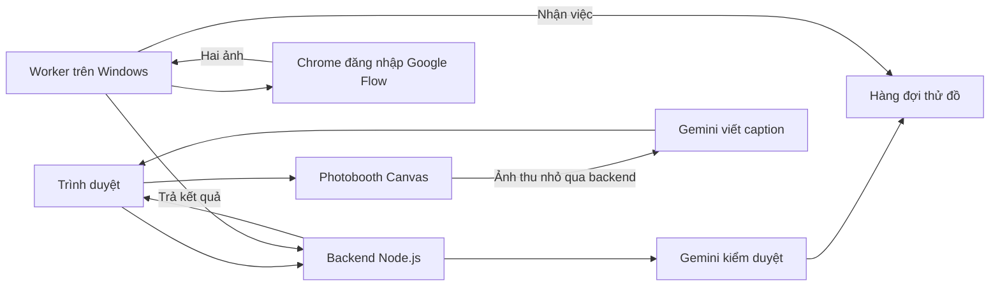

# Việt Phục Remix

**Khám phá vùng đất · Hiểu nét áo · Thử Việt phục trên ảnh của bạn**

Việt Phục Remix giúp người dùng khám phá trang phục Việt theo địa phương, cá nhân hóa bản phối và tạo ảnh thử đồ bằng AI. Từ bản đồ di sản đến phòng thử đồ, photobooth và caption, trải nghiệm kết nối **con người – trang phục – phong cảnh – câu chuyện văn hóa**.

🌐 **[Trải nghiệm website](https://viet-phuc-remix.ai.studio/)**

## Ý tưởng và bài toán

Người trẻ quan tâm đến Việt phục nhưng chưa dễ chọn trang phục phù hợp, hiểu bối cảnh văn hóa hoặc hình dung bản thân khi mặc. Sản phẩm dành cho học sinh, sinh viên và người yêu văn hóa, thời trang, du lịch, với hành trình:

**Chọn vùng đất → khám phá trang phục → tùy chỉnh bản phối và phong cảnh → tải ảnh → thử đồ → tạo photobooth → xin chữ và chia sẻ.**

Mỗi địa phương có tủ đồ và bối cảnh riêng: chọn Sa Pa mở váy xòe cùng cảnh Mường Hoa, Cát Cát hoặc Fansipan; chọn Huế mở Nhật Bình, ngũ thân, áo dài cùng cảnh cố đô.

## Chức năng hiện có

| Khu vực | Trải nghiệm |
| --- | --- |
| Trang chủ | Giới thiệu sản phẩm và các bản phối nổi bật |
| Bản đồ di sản | Năm vùng văn hóa, chọn địa phương, phóng to/thu nhỏ, giới hạn kéo và di chuyển nhanh Bắc – Trung – Nam |
| Bộ sưu tập | Thẻ bản phối có minh họa, bộ lọc và chuyển lựa chọn sang phòng thử đồ |
| Phòng thử đồ | Ảnh chân dung/toàn thân, trang phục, màu sắc, phong cách, sự kiện, phụ kiện và phong cảnh địa phương |
| Kết quả | Hai ảnh thử đồ, bảng màu, giải thích phối đồ và thông tin văn hóa |
| Photobooth | Dải bốn ô, thẻ dọc 9:16, trước/sau 4:5; tùy chỉnh màu khung, chữ và dấu triện; xuất PNG |
| Xin chữ | Gemini đọc ảnh photobooth để viết caption; sao chép kèm chữ ký và hashtag được hiển thị trước |
| Hướng dẫn, về dự án | Cách sử dụng, chọn ảnh và định hướng sản phẩm |

Những điểm tạo dấu ấn:

- **11 địa phương:** Sa Pa, Bắc Ninh, Hà Nội, Mộc Châu, Hà Giang, Huế, Hội An, Buôn Ma Thuột, Pleiku, Sài Gòn và Cần Thơ; có chế độ phối tự do.
- Preview thể hiện hình dáng từng nhóm trang phục, bên cạnh lựa chọn màu.
- Phong cảnh có thể tùy chỉnh ánh sáng, thời tiết và góc chụp.
- Câu chuyện văn hóa trong phòng chờ chuyển mỗi 12 giây.
- Nhạc không lời theo vùng trên bản đồ, nhạc thư giãn trong phòng thử đồ và giai điệu riêng cho các trang khác.
- Nhạc bắt đầu sau tương tác, mặc định 12% âm lượng; có bật/tắt, chỉnh âm lượng, nhớ lựa chọn và tạm dừng khi ẩn tab.
- Giao diện thích ứng điện thoại/máy tính, hiệu ứng chuyển cảnh và hỗ trợ giảm chuyển động.
- Kiểm tra văn bản ở frontend/backend, kiểm duyệt ảnh bằng Gemini và thông báo từ chối dễ hiểu.

## Công nghệ và luồng xử lý



| Thành phần | Công nghệ |
| --- | --- |
| Frontend | HTML, CSS, JavaScript thuần; SVG bản đồ/minh họa; Canvas photobooth |
| Backend | Node.js HTTP server, hàng đợi trong RAM, API xác thực cho worker |
| AI | Google Gemini kiểm duyệt và viết caption; Google Flow tạo ảnh |
| Cầu nối Flow | Playwright điều khiển Chrome qua CDP trên Windows |
| Nhạc | 11 loop MP3 tổng hợp nguyên gốc, tải khi cần và chuyển nhạc có fade |
| Kiểm thử | Node Test Runner và Playwright |

Web hiện tại chạy độc lập với n8n. Các workflow n8n trong repository thuộc giai đoạn phát triển trước, được giữ để tham khảo.

## Chạy nhanh trên máy

Yêu cầu **Node.js 22 trở lên** và Git. Backend dùng thư viện có sẵn của Node.js, không cần cài dependency để chạy web.

```powershell
git clone https://github.com/fucdunko23-uet-vnu/vietphuc_remix.git
cd vietphuc_remix\ai-studio-app
npm.cmd start
```

Mở **http://127.0.0.1:3000**. Có thể khám phá bản đồ, bộ sưu tập và xem preview khi chưa cấu hình AI. Để tạo ảnh, cấu hình Gemini và bật Flow worker theo các bước dưới đây.

### 1. Cấu hình backend và Gemini

Tại `ai-studio-app`, tạo `.env` từ mẫu nếu chưa có:

```powershell
Copy-Item .env.example .env
```

Điền khóa Google của bạn và một token ngẫu nhiên dùng riêng cho worker:

| Biến | Công dụng |
| --- | --- |
| `PORT` | Cổng web; mặc định `3000` |
| `HOST` | Mẫu local dùng `127.0.0.1`; hosting thường dùng `0.0.0.0` |
| `GEMINI_API_KEY` | Khóa Gemini chỉ dùng ở backend; cũng chấp nhận `GOOGLE_API_KEY` |
| `MODERATION_MODEL` | Model kiểm duyệt; mặc định trong mã là `gemini-3.5-flash-lite` |
| `CAPTION_MODEL` | Model đọc ảnh photobooth; mặc định trong mã là `gemini-3.5-flash-lite` |
| `FLOW_WORKER_TOKEN` | Token bí mật; phải trùng `workerToken` trong cấu hình worker |

Chọn model mà Google project của bạn có quyền sử dụng. Hạn mức Gemini API và tín dụng Flow là hai phần riêng biệt.

`npm.cmd start` không tự nạp `.env`. Dừng web bằng `Ctrl+C`, rồi chạy:

```powershell
node --env-file=.env server.cjs
```

### 2. Kết nối Google Flow

Worker hiện có đường dẫn Playwright cố định tại `D:/n8n/node_modules/playwright-core`. Máy vận hành cần Windows, Google Chrome và tài khoản Flow đã đăng nhập.

Từ **thư mục gốc repository**, mở PowerShell khác:

```powershell
npm.cmd install --prefix D:\n8n playwright-core
Copy-Item worker-config.example.json worker-config.json
```

Sửa `worker-config.json`: đặt `workerToken` bằng `FLOW_WORKER_TOKEN` của backend; giữ `appUrl` là `http://127.0.0.1:3000` để kết nối web local.

```powershell
.\Connect-AI-Studio.cmd
```

Trong cửa sổ Chrome vừa mở, truy cập **https://flow.google.com/** và đăng nhập. Script dùng hồ sơ riêng tại `D:\n8n\flow-browser`, cổng CDP cục bộ `9223`. Giữ Chrome mở, rồi chạy worker từ thư mục gốc:

```powershell
$env:VIET_PHUC_CONFIG = Join-Path (Get-Location) 'worker-config.json'
node .\flow-worker.cjs
```

Mở **http://127.0.0.1:3000/api/status**. Khi `ready` là `true`, phòng thử đồ sẵn sàng nhận ảnh. Giữ máy, mạng và Chrome hoạt động trong suốt lượt tạo.

Các launcher `Start-Viet-Phuc.cmd`, `run-local-app.cjs` và công cụ nhập khóa là tiện ích của máy đã cấu hình tại `D:\n8n`; cần điều chỉnh đường dẫn khi chuyển máy. `Start-Viet-Phuc.cmd` chỉ bật worker, không khởi động web local. Không chạy lại `init-worker-config.cjs` trên cấu hình đang dùng vì script tạo lại token.

### 3. Chạy thử một lượt

1. Mở bản đồ, chọn địa phương rồi vào phòng thử đồ.
2. Chọn trang phục, màu, phụ kiện và phong cảnh.
3. Tải ảnh JPG, PNG hoặc WebP mà bạn có quyền sử dụng, rồi bắt đầu thử đồ.
4. Sau khi có hai ảnh, tạo photobooth, tùy chỉnh khung, xem caption và tải PNG.

Tạo ảnh thật sử dụng tài khoản và tín dụng Flow đã kết nối.

## Cấu trúc repository

```text
ai-studio-app/
├── public/
│   ├── index.html                 # Các trang và hộp thoại
│   ├── style.css, site.css        # Giao diện và responsive
│   ├── app.js, site.js            # Thử đồ, photobooth và điều hướng
│   ├── map.js                    # Bản đồ di sản
│   ├── destinations.js           # Tủ đồ và cảnh theo địa phương
│   ├── garment-preview.js        # Preview theo loại trang phục
│   ├── guardrails.js             # Kiểm tra văn bản phía trình duyệt
│   ├── music.js, audio/          # Trình phát và nhạc nền
│   └── collection-art/           # Minh họa SVG bộ sưu tập
├── server.cjs                    # HTTP server và API
├── styling.cjs                   # Quy tắc phối và prompt
├── moderation.cjs                # Kiểm duyệt Gemini
├── caption.cjs                   # Caption từ ảnh
├── .env.example                  # Mẫu cấu hình backend
└── *.test.cjs                    # Kiểm thử backend
flow-worker.cjs                   # Cầu nối Google Flow
worker-config.example.json        # Mẫu cấu hình worker
test-assets/                      # Ảnh mẫu dùng cho kiểm thử
scratch/                          # Công cụ kiểm tra và phát triển
tools/generate-background-music.py # Tạo tài nguyên âm thanh
src/                              # Mã hỗ trợ workflow và minh họa
Viet-phuc-*.n8n.json               # Workflow n8n giai đoạn trước
Xem-truoc-*.html                   # Preview HTML độc lập giai đoạn trước
```

Ưu tiên sửa ứng dụng trong `ai-studio-app/`. Các script `build*.cjs` và tài liệu cũ phục vụ những giai đoạn trước; đọc trước khi chạy để tránh ghi đè giao diện hiện tại.

## Kiểm thử

Từ `ai-studio-app`:

```powershell
npm.cmd test
npm.cmd run build
```

`test` kiểm tra backend, địa phương, kiểm duyệt và caption. `build` kiểm tra cú pháp JavaScript; frontend được phục vụ trực tiếp, không cần bundle. Giữ `test-assets/` cạnh `ai-studio-app/` vì các test đọc ảnh mẫu ở đó.

Kiểm tra giao diện từ thư mục gốc, với Chrome và Playwright đã cài:

```powershell
node .\test-logic-regressions.cjs
node .\scratch\audit-all-pages.cjs
node .\scratch\check-music.cjs
```

Các lệnh trên không tạo ảnh Flow thật. Những script có tên `test-flow-live`, `test-published-live` hoặc tương tự có thể gọi Google và sử dụng tín dụng; đọc nội dung trước khi chạy.

## Triển khai trên AI Studio hoặc hosting Node.js

- Triển khai toàn bộ `ai-studio-app/`, gồm backend và tài nguyên `public/`; đây không phải ứng dụng chỉ có file tĩnh.
- Khởi động bằng `node server.cjs`; đặt `HOST=0.0.0.0`, cổng theo môi trường và các khóa trong Secrets/biến môi trường.
- Bản AI Studio hiện có điều chỉnh riêng cho cổng gateway preview và alias `/index.html`; giữ các điều chỉnh đó khi cập nhật backend.
- Đặt `appUrl` của worker thành URL HTTPS đã xuất bản, với token trùng backend. Worker Windows vẫn cần chạy khi dùng web trên cloud.
- Kiểm tra `/api/status` và `/healthz`; gateway của Google có thể xử lý `/healthz` riêng.
- Chờ lượt tạo ảnh hoàn tất trước khi khởi động lại hoặc triển khai backend.

Hàng đợi hiện nằm trong RAM của **một tiến trình**, giới hạn ba lượt đang kiểm duyệt/chờ/chạy; worker xử lý lần lượt. Khởi động lại làm mất lượt đang xử lý. Để chạy nhiều instance cần hàng đợi và dữ liệu dùng chung.

## Văn hóa, dữ liệu và giới hạn

- Ảnh AI giúp hình dung cách phối, không xác nhận độ vừa vặn hay độ chính xác lịch sử. Danh mục hiện tại chưa đại diện đầy đủ cho mọi cộng đồng.
- Ảnh đầu vào được gửi đến Gemini để kiểm duyệt, rồi đến tài khoản Flow của ứng dụng. Ảnh có thể được lưu trong dự án Flow; ứng dụng không tự xóa dự án Google.
- Job hết hạn sau 20 phút; frontend yêu cầu xóa job sau khi nhận ảnh. Quyền xin caption và ngữ cảnh được giữ đến hết thời gian còn lại, không giữ ảnh job trong phiên caption.
- Photobooth gửi ảnh thu nhỏ đến Gemini; ảnh PNG tải về giữ chất lượng dựng trên canvas. Nếu Gemini lỗi, caption dự phòng được ghi nhãn.
- Cầu nối Flow phụ thuộc giao diện Google và phiên đăng nhập; có thể cần cập nhật khi giao diện thay đổi hoặc Google yêu cầu xác minh.
- Nhạc được tổng hợp nguyên gốc bằng mã nguồn, gợi không khí vùng miền; không phải bản thu âm nhạc dân gian xác thực. Xem [nguồn nhạc và cách tạo lại](ai-studio-app/public/audio/README.md).
- Chưa có lưu trữ bộ sưu tập cá nhân lâu dài, đo kích cỡ hoặc thử đồ trực tiếp qua camera.

Tài liệu chi tiết: [Guardrails](ai-studio-app/GUARDRAILS.md) · [Caption photobooth](ai-studio-app/CAPTIONS.md).

## Quy tắc đưa mã nguồn lên Git

`.gitignore` loại dependency, `.env`, khóa, cấu hình worker thật, hồ sơ Chrome, dữ liệu n8n, log, ảnh kết quả, báo cáo kiểm thử và gói xuất bản. Mã nguồn, tài nguyên UI/nhạc, ảnh mẫu kiểm thử và file cấu hình mẫu được giữ lại.

Không đưa khóa Google, worker token hoặc cookie đăng nhập vào frontend hay commit. `.gitignore` chỉ áp dụng cho file chưa được theo dõi; kiểm tra `git diff --cached` trước khi push. Nếu khóa từng xuất hiện trong lịch sử Git, cần thu hồi và thay khóa.
